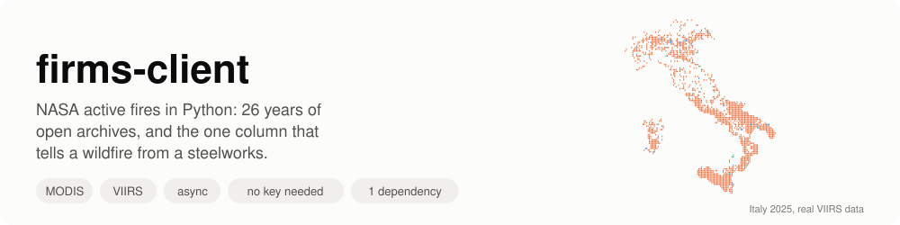
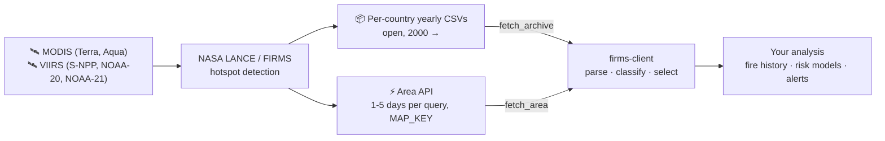
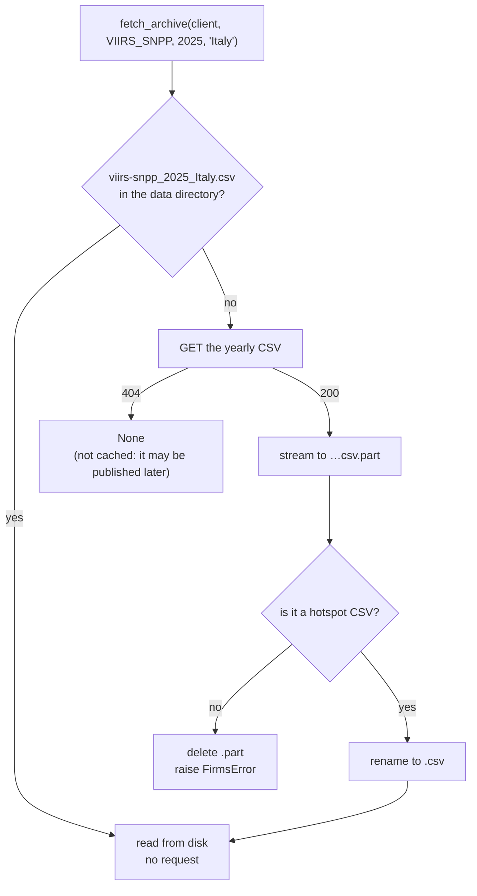
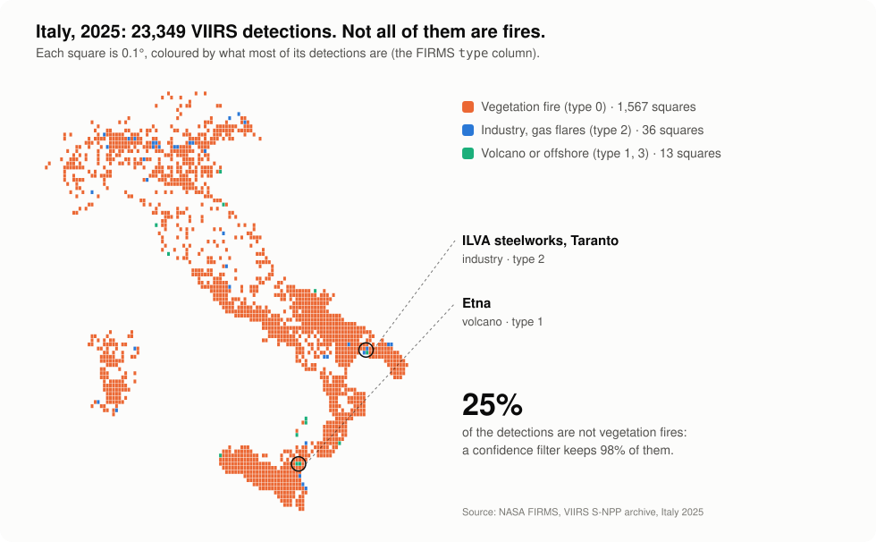
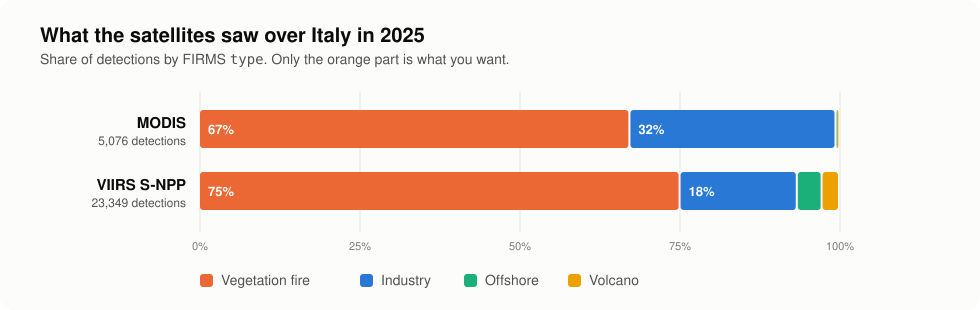
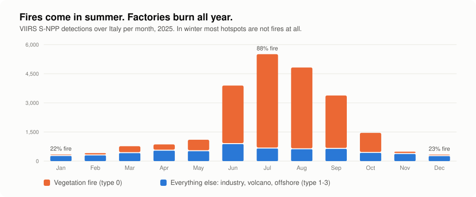
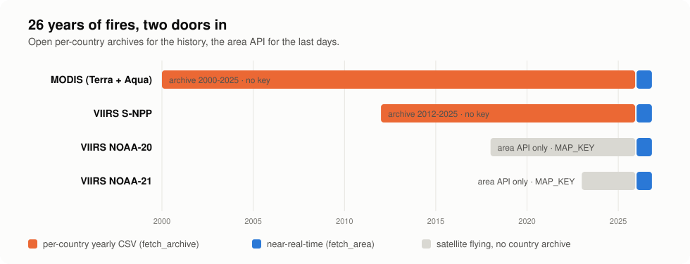
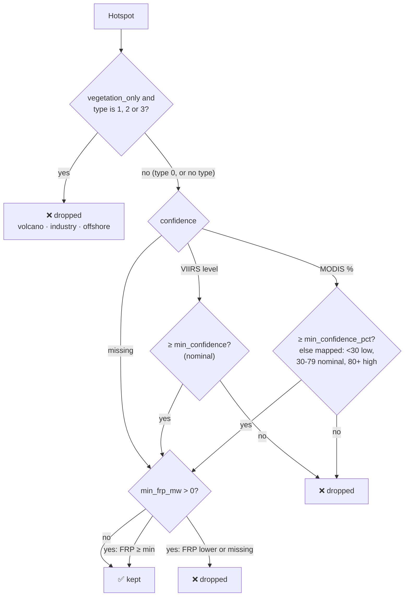

<p align="center">
  
</p>

<p align="center">
  <a href="https://github.com/agent-engineering-studio/firms-client/actions/workflows/ci.yml"></a>
  <a href="https://pypi.org/project/firms-client/"></a>
  
  
  
  <a href="./LICENSE"></a>
</p>

**firms-client** is a small, typed, async Python library for
[NASA FIRMS](https://firms.modaps.eosdis.nasa.gov/), the **Fire Information
for Resource Management System**: every active fire seen from space since
2000. It downloads the **open per-country archives** (no account, no key),
queries the **near-real-time area API**, and does the parsing that tells a
**vegetation fire from a steelworks**.

```python
rows = await fetch_archive(client, VIIRS_SNPP, 2025, "Italy")  # 23,349 detections, no key
fires = select(rows)  # 14,880 vegetation fires
```

One dependency: `httpx`. Website: **[agentengineering.it/firms-client](https://agentengineering.it/firms-client/)**, with the [roadmap](https://agentengineering.it/firms-client/roadmap.html).

---

## Contents

- [What is FIRMS, in 30 seconds](#what-is-firms-in-30-seconds)
- [What this library does](#what-this-library-does)
- [Who is it for](#who-is-it-for)
- [Quick start](#quick-start)
- [Where downloads are saved](#where-downloads-are-saved)
- [Not every hotspot is a fire](#not-every-hotspot-is-a-fire)
- [How it works](#how-it-works)
- [Recipes](#recipes)
- [The traps we already fell into](#the-traps-we-already-fell-into)
- [API at a glance](#api-at-a-glance)
- [Contributing](#contributing) · [Ideas to work on](#ideas-to-work-on)
- [Data licence and credits](#data-licence-and-credits)

---

## What is FIRMS, in 30 seconds

Several satellites look at the whole Earth a few times a day with
**thermal infrared** sensors. When a pixel is much hotter than its
surroundings, it is reported as a **hotspot**: a point with a position, a
time, a brightness temperature, a fire radiative power (FRP, in MW) and a
confidence. NASA collects them in FIRMS, a few hours after the overpass.



What people use it for:

- a **fire history** of a country or region, year by year, for 26 years;
- a **wildfire trigger**: something is burning in my area right now;
- **training data** for fire-risk and burnt-area models;
- **air-quality and emissions** work, from the radiative power of each fire.

## What this library does

| | Feature | In plain words |
|---|---|---|
| 📦 | **Open yearly archives** | MODIS from 2000 and VIIRS S-NPP from 2012, per country, with **no Earthdata login and no key**. |
| 💾 | **Never download twice** | Archives are saved in a persistent data directory and read from disk next time. |
| ⚡ | **Near-real-time area API** | The last days over any bounding box, with a free MAP_KEY. |
| 🔥 | **Fire or factory?** | Every detection carries its FIRMS `type`: vegetation, volcano, industry, offshore. |
| 🎚️ | **One confidence scale** | MODIS percentages and VIIRS `l`/`n`/`h` (or `low`/`nominal`/`high`) judged by one rule. |
| 🛡️ | **Errors that look like errors** | A missing year is `None`, a bad key or an error page with HTTP 200 raises `FirmsError`. |
| 🧪 | **Pure functions too** | URLs and parsing are plain functions, if you have your own HTTP stack. |
| 🪶 | **Light** | One dependency (`httpx`), fully typed (`mypy --strict`), 100% test coverage. |

## Who is it for

- **Researchers and students** in remote sensing, ecology and climate who
  want FIRMS data in a notebook or pipeline, without the e-mail order form.
- **Data engineers** who need a repeatable national fire history.
- **Civil protection and risk teams** who want a wildfire trigger over
  their area, with industrial sources already filtered out.

It started inside [Limen](https://github.com/agent-engineering-studio/limen),
which uses the archives as the fire history of Italy and the area API as a
wildfire trigger, and was extracted so that anyone can use it.

---

## Quick start

### 1. Install

```bash
pip install firms-client
```

Python 3.12 or newer.

### 2. Download a country's year, no key needed

```python
import asyncio
from collections import Counter

import httpx

from firms_client import ARCHIVE_PRODUCTS, fetch_archive, select


async def main() -> None:
    async with httpx.AsyncClient(timeout=120) as client:
        for product in ARCHIVE_PRODUCTS:
            rows = await fetch_archive(client, product, 2025, "Italy")
            if rows is None:  # that year is not published (yet)
                continue
            fires = select(rows)  # vegetation fires, nominal confidence or better
            types = dict(sorted(Counter(r.detection_type for r in rows).items()))
            print(product.slug, len(rows), "detections", types, "->", len(fires), "fires")


asyncio.run(main())
```

```
modis 5076 detections {0: 3414, 1: 21, 2: 1635, 3: 6} -> 3315 fires
viirs-snpp 23349 detections {0: 17533, 1: 633, 2: 4277, 3: 906} -> 14880 fires
```

The CSVs are now in `~/.cache/firms-client/`: run it again and nothing is
downloaded. The country is its English name, as FIRMS writes it (`Italy`,
`Greece`, `United_States`…).

### 3. Or the last days, with a MAP_KEY

The archive runs up to the previous year. For the last days, get a free
[MAP_KEY](https://firms.modaps.eosdis.nasa.gov/api/map_key/) (an e-mail
address is enough) and ask the area API:

```python
from firms_client import fetch_area, select

ITALY = (6.0, 36.0, 19.0, 47.6)  # west, south, east, north

rows = await fetch_area(client, MAP_KEY, "VIIRS_SNPP_NRT", ITALY, days=3)
fires = select(rows, min_frp_mw=1.0)
```

`days` goes from 1 to 5 (the API's limit). Without a date it is the last
`days` days up to today; `on_date=date(2026, 8, 1)` asks for the `days` days
**starting** on that date. For a longer range, `fetch_area_range` splits it
into 5-day requests:

```python
from datetime import date

from firms_client import RetryPolicy, fetch_area_range

july = await fetch_area_range(
    client,
    MAP_KEY,
    "VIIRS_SNPP_SP",
    ITALY,
    date(2025, 7, 1),
    date(2025, 7, 31),
    retry=RetryPolicy(),  # 429, 5xx and dropped connections, with backoff
)
```

The area API is near-real-time and is never cached. Its rows carry **no
`type`**, so `select()` cannot drop industrial sources from them: see
[the roadmap](https://agentengineering.it/firms-client/roadmap.html#gap).

### 4. Or from a shell

```bash
firms archive Italy 2025                      # a summary, by type
firms archive Italy 2025 --fires --format geojson > fires.geojson
firms archive Greece 2024 --product modis --format csv
FIRMS_MAP_KEY=… firms area --bbox 6,36,19,47.6 --days 3 --fires
FIRMS_MAP_KEY=… firms area --bbox 6,36,19,47.6 --source VIIRS_SNPP_SP --from 2025-07-01 --to 2025-07-31
FIRMS_MAP_KEY=… firms area --bbox 6,36,19,47.6 --days 2 --mask Italy --fires   # without the steelworks
firms anomaly Italy 2017 --month 7
```

```
23349 detections
  vegetation fire: 17533
  active volcano: 633
  static land source: 4277
  offshore: 906
from 2025-01-01 to 2025-12-31, busiest day 2025-07-22
FRP: max 420.84 MW, total 148141 MW
```

The command line retries on 429, 5xx and dropped connections.

### 5. Or ask an agent: the MCP server

`firms-mcp` exposes FIRMS as tools over the
[Model Context Protocol](https://modelcontextprotocol.io/), for Claude Code,
Claude Desktop or any MCP client:

```bash
pip install 'firms-client[mcp]'

# Claude Code
claude mcp add firms -e FIRMS_MAP_KEY=your-key -- firms-mcp
```

```json
{
  "mcpServers": {
    "firms": {
      "command": "uvx",
      "args": ["--from", "firms-client[mcp]", "firms-mcp"],
      "env": { "FIRMS_MAP_KEY": "your-key" }
    }
  }
}
```

That is Claude Desktop's `claude_desktop_config.json`. The MAP_KEY is only
needed for the area API, and stays on the server: the model never sees it.

| Tool | Answers |
|---|---|
| `fire_history(country, product, first_year, last_year, bbox)` | detections and fires per year, from the open archives |
| `archive_digest(country, year, product, bbox, top_events)` | one year: by type and month, largest events, hottest cells |
| `area_digest(bbox, source, days \| start+end, top_events, mask_country)` | the area API, last days or any range; with `mask_country`, without static sources |
| `season_anomaly(country, year, month, product, bbox, first_year)` | was this year or month unusual? rank, percentile, robust z |
| `export_geojson(country, year, filename, product, bbox, fires_only)` | a GeoJSON file in `FIRMS_EXPORT_DIR` (default: `exports/` in the data directory) |

Every tool answers with a `summarize()` digest of a few kilobytes, never raw
rows, so the numbers an agent quotes are computed here. The server's
instructions and the `firms://guide` resource carry the traps (type,
presence-only, no `type` in near-real-time data) and `firms://attribution`
carries the NASA acknowledgement. Ask it *"how did the 2021 fire season in
Sicily compare with 2025?"*: it calls `fire_history` with Sicily's bbox.

---

## Where downloads are saved

Yearly archives go to the directory you pass (`directory=` on
`fetch_archive`, `fetch_archive_csv` and `download_archive`). If you pass
none:

1. `FIRMS_DATA_DIR`, if set;
2. otherwise `~/.cache/firms-client` (or `$XDG_CACHE_HOME/firms-client`).

```
~/.cache/firms-client/
├── modis_2025_Italy.csv          400 KB
├── viirs-snpp_2025_Italy.csv     1.8 MB
└── viirs-snpp_2024_Italy.csv     …
```



A file that exists is whole: downloads are streamed to a `.part` file and
renamed only when complete. To refresh a year, delete its file.

In **Docker**, point it at a volume so the data survives the container:

```yaml
services:
  app:
    environment:
      FIRMS_DATA_DIR: /data/firms
    volumes:
      - firms-data:/data/firms
volumes:
  firms-data:
```

It is the same convention as
[egms-client](https://github.com/agent-engineering-studio/egms-client)
(`EGMS_DATA_DIR`), so one volume can hold both under `/data`.

---

## Not every hotspot is a fire

A satellite sees **heat**, not fire. Steelworks, refineries, gas flares,
volcanoes and offshore platforms are hot every day of the year, and they
come through at **high confidence**, because they really are hot. FIRMS
labels every detection with a `type`:

| `type` | Constant | Meaning |
|:---:|---|---|
| `0` | `VEGETATION_FIRE` | presumed vegetation fire |
| `1` | `ACTIVE_VOLCANO` | active volcano |
| `2` | `STATIC_LAND_SOURCE` | other static land source: industry, gas flares |
| `3` | `OFFSHORE` | offshore |

<p align="center">
  
</p>

On Italy, about **a quarter** of the VIIRS detections are not vegetation
fires, and 98% of those pass a nominal-confidence filter. Without
`type == 0`, the most "burnt" square kilometre in the country over the
whole archive is the ILVA steelworks in Taranto, with **3,308 fire-days**.

<p align="center">
  
</p>

| Italy, 2025 | Detections | Vegetation (0) | Volcano (1) | Industry (2) | Offshore (3) | `select()` keeps |
|---|---:|---:|---:|---:|---:|---:|
| MODIS | 5,076 | 3,414 | 21 | 1,635 | 6 | 3,315 |
| VIIRS S-NPP | 23,349 | 17,533 | 633 | 4,277 | 906 | 14,880 |

The difference is starkest in winter, when there are few real fires and
the factories keep burning:

<p align="center">
  
</p>

<details>
<summary>The numbers behind the chart</summary>

| VIIRS S-NPP, Italy 2025 | Jan | Feb | Mar | Apr | May | Jun | Jul | Aug | Sep | Oct | Nov | Dec |
|---|---:|---:|---:|---:|---:|---:|---:|---:|---:|---:|---:|---:|
| Vegetation fire | 76 | 117 | 357 | 322 | 590 | 3,018 | 4,859 | 4,214 | 2,751 | 1,034 | 118 | 77 |
| Everything else | 263 | 292 | 411 | 538 | 509 | 875 | 648 | 609 | 628 | 422 | 366 | 255 |

</details>

Two things no filter fixes: **crop-residue burning** is a real vegetation
fire (`type` 0), and only land cover can set it apart; and FIRMS is
**presence-only**, so no detection does not mean nothing burnt (clouds,
smoke and the time of the overpass all hide fires).

All the images above are drawn from the real archives by
[`docs/make_images.py`](./docs/make_images.py), with this library.

---

## How it works

### Two doors in: archives and area API

<p align="center">
  
</p>

| | Per-country archive | Area API |
|---|---|---|
| Function | `fetch_archive`, `download_archive` | `fetch_area` |
| What | one country, one whole year | any bounding box, 1-5 days per query |
| Products | `MODIS` (2000-), `VIIRS_SNPP` (2012-) | `VIIRS_SNPP_NRT`, `VIIRS_NOAA20_NRT`, `VIIRS_NOAA21_NRT`, `MODIS_NRT` (`NRT_SOURCES`) |
| Key | none | free MAP_KEY |
| Latency | up to the previous year | about 3 hours |
| Processing | standard (SP), with `type` | near-real-time |
| Cached on disk | yes | no |
| URL | `…/data/country/{product}/{year}/{product}_{year}_{country}.csv` | `…/api/area/csv/{key}/{source}/{w,s,e,n}/{days}[/{date}]` |

### From a CSV row to a `Hotspot`

MODIS and VIIRS share one layout, with two differences the parser absorbs:
confidence (a percentage for MODIS, a level for VIIRS) and the 4 µm
brightness column (`brightness` vs `bright_ti4`). Every row becomes a frozen
dataclass:

| Field | Type | Example | Notes |
|---|---|---|---|
| `latitude`, `longitude` | `float` | `40.52`, `17.21` | degrees, WGS84 |
| `acq_date` | `date` | `2025-07-24` | UTC |
| `acq_time` | `int` | `126` | UTC `HHMM`: `126` is 01:26 |
| `confidence` | `str \| None` | `"n"`, `"high"`, `"87"` | as written; see `confidence_level` |
| `frp_mw` | `float \| None` | `12.4` | fire radiative power, MW |
| `brightness_k` | `float \| None` | `331.2` | 4 µm brightness temperature, K |
| `daynight` | `str \| None` | `"D"` | day or night overpass |
| `satellite`, `instrument` | `str \| None` | `"N"`, `"VIIRS"` | |
| `detection_type` | `int \| None` | `0` | the FIRMS `type`; `is_vegetation_fire` reads it |
| `brightness_t5_k` | `float \| None` | `274.9` | 11 µm brightness, K (`bright_ti5` / `bright_t31`) |
| `scan_km`, `track_km` | `float \| None` | `0.4`, `0.37` | pixel size along scan and track |
| `version` | `str \| None` | `"2"`, `"2.0NRT"` | collection and processing |

Rows without coordinates, date or a valid time are skipped.

### What `select()` keeps



`select(rows, vegetation_only=True, min_confidence="nominal",
min_confidence_pct=None, min_frp_mw=0.0)`:

- a row **without `type`** is kept, since it cannot be judged;
- a **missing confidence** is kept: losing a real fire is worse than keeping
  a doubtful pixel;
- `confidence_level("87")` → `"high"`, `confidence_level("n")` → `"nominal"`:
  use it to put both instruments on one scale yourself.

### What happens on errors

| FIRMS answers | You get |
|---|---|
| archive year not published (404 with a JSON body) | `None` |
| an error page with HTTP 200 instead of a CSV | `FirmsError` |
| bad MAP_KEY or source (HTTP 400, plain text `Invalid MAP_KEY.`) | `FirmsError` |
| area API, nothing detected (empty body) | `[]` |
| 5xx, timeouts, network errors | `httpx` exceptions, untouched, unless you pass `retry=RetryPolicy()` |

---

## Recipes

### The fire history of a country

```python
from firms_client import VIIRS_SNPP, archive_years, fetch_archive, select


async def history(client: httpx.AsyncClient, country: str) -> dict[int, int]:
    """Vegetation fires per year; the first run downloads, the next ones read from disk."""
    per_year = {}
    for year in archive_years(VIIRS_SNPP, until=2025):
        rows = await fetch_archive(client, VIIRS_SNPP, year, country)
        if rows is not None:
            per_year[year] = len(select(rows))
    return per_year
```

### Fire-days per square kilometre

Run it with and without `select()` to find your country's steelworks:

```python
from collections import defaultdict

days: dict[tuple[float, float], set[date]] = defaultdict(set)
for year in archive_years(VIIRS_SNPP, until=2025):
    for r in await fetch_archive(client, VIIRS_SNPP, year, "Italy") or []:
        days[round(r.latitude, 2), round(r.longitude, 2)].add(r.acq_date)

hottest = sorted(days.items(), key=lambda kv: len(kv[1]), reverse=True)[:5]
for (lat, lon), d in hottest:
    print(f"{lat:.2f}, {lon:.2f}: {len(d)} fire-days")
```

### A monthly chart

With `pip install matplotlib`:

```python
import matplotlib.pyplot as plt

rows = await fetch_archive(client, VIIRS_SNPP, 2025, "Italy")
fires = [0] * 12
other = [0] * 12
for r in rows:
    (fires if r.is_vegetation_fire is not False else other)[r.acq_date.month - 1] += 1

months = range(1, 13)
plt.bar(months, other, label="industry, volcano, offshore")
plt.bar(months, fires, bottom=other, label="vegetation fire")
plt.legend()
plt.title("VIIRS detections over Italy, 2025")
plt.show()
```

### GeoJSON for QGIS or a web map

```python
import json

from firms_client import to_csv, to_geojson

Path("fires.geojson").write_text(json.dumps(to_geojson(select(rows))))
Path("fires.csv").write_text(to_csv(select(rows)))  # every field, one row per hotspot
```

### Fire events, not pixels

One fire is often dozens of hotspots, seen by several satellites over
several days. `cluster` links hotspots within `radius_m` and `gap_days` of
each other into `FireEvent`s, the largest by total FRP first:

```python
from firms_client import cluster

events = cluster(select(rows), radius_m=750, gap_days=1)  # VIIRS; ~2000 m for MODIS
for e in events[:3]:
    print(e.start, e.days, "days", e.size, "hotspots", f"{e.total_frp_mw:.0f} MW", e.bbox)
```

On Italy in 2025 the 14,880 VIIRS fires make 8,250 events.

### A digest for people and LLMs

`summarize` does the counting and returns a JSON-ready dict of a few
kilobytes: counts by type, month and day/night, the fires `select()` keeps,
the largest events, the cells hot on the most days, the caveats and the
NASA attribution. Put it in a prompt instead of 23,000 rows: every number
in it comes from code.

```python
from firms_client import summarize

digest = summarize(rows, top_events=10, top_cells=5)
digest["hot_cells"][0]
# {'latitude': 45.15, 'longitude': 9.94, 'fire_days': 212, 'detections': 430,
#  'not_vegetation_share': 0.991}
```

From a shell: `firms archive Italy 2025 --format json`.

### Near-real-time data without the steelworks

Area API rows have no `type`, so `select()` keeps every steelworks and
volcano. A **static-source mask** learns from a country's archives where
they are, cell by cell (0.01°), and gives live rows the `type` of the place
they fall in:

```python
from firms_client import fetch_static_mask

mask = await fetch_static_mask(client, "Italy")  # built once from 2012-last year, then cached
live = await fetch_area(client, MAP_KEY, "VIIRS_NOAA21_NRT", ITALY, days=1)
fires = select(mask.label(live))  # industry, volcanoes and platforms drop out
```

A cell is static when most of its archive detections are FIRMS `type`
1-3 (`labelled`), or when it burned on at least 30 days, in 6 years and
in 8 different months (`persistent`: a source FIRMS calls vegetation).
`mask.verdict(h)` says which, with the history behind it, and
`label(..., spare_frp_mw=50)` keeps strong detections untouched.

How well does it work? The mask was learned on Italy 2012-2024, then the
2025 archive was stripped of its `type`, as live data are, and labelled
([`docs/evaluate_mask.py`](./docs/evaluate_mask.py)):

| Italy 2025, `type` hidden | |
|---|---:|
| static detections (FIRMS type 1-3) caught | **99.3%** (5,773 / 5,816) |
| of those, with the right type | 97.1% |
| precision | 91.6% |
| FIRMS type 0 masked | 3.0% (530 / 17,533) |
| `select()` without the mask | 20,605 fires, 5,725 of them static |
| `select()` with the mask | 14,430 fires, **42** of them static |

Part of the "type 0 masked" are not mistakes: the Etna lava flow of
February 2025, and type-0 detections inside the Taranto steelworks.

### Is this season unusual?

`season_anomaly` puts a year, or a month of it, against every other
archive year: rank, percentile and a robust z-score (median and MAD).

```python
from firms_client import season_anomaly

a = await season_anomaly(client, "Italy", 2017, month=7)
a.describe()  # '2017: 7,552, the highest of 14 years (robust z +3.8)'
```

From a shell: `firms anomaly Italy 2017 --month 7`, or
`firms anomaly Italy 2021 --bbox 12.3,36.6,15.7,38.35` for Sicily.

### Grounded alert bulletins

When the trigger finds a new event, an LLM can draft the few lines an
operator needs, in their language. Code gathers the facts; the model only
writes; every number and place in the draft is then checked against the
facts. With `pip install 'firms-client[claude]'`:

```python
from firms_client import ClaudeWriter, Place, bulletin_facts, draft_bulletin

places = [
    Place("Caltanissetta", 37.4901, 14.0629),
    Place("Enna", 37.5670, 14.2795),
]  # your gazetteer
facts = bulletin_facts(event, places=places, mask=mask, anomaly=season, region="Sicily")
draft = await draft_bulletin(facts, ClaudeWriter(), language="it")

if draft.grounded:
    print(draft.as_text())  # a draft for the operator, never a public alert
else:
    print(draft.problems)  # e.g. ["number '300' is not in the facts", "place 'Corleone' ..."]
```

- `bulletin_facts` has the event (first and last time seen, peak and total
  FRP, overpasses, satellites, day and night detections), the nearest
  places from **your** gazetteer with distance and direction, the
  static-source verdict when the mask knows the place, the season's
  anomaly, and the caveats. The model is never asked where places are.
- `draft_bulletin` asks for structured output (`BULLETIN_SCHEMA`) and runs
  `check_grounding`: numbers must be facts or facts rounded, places must be
  in the facts. A draft that strays is sent back once with the list of
  problems; if it still strays, `grounded` is false and `problems` says why.
- `ClaudeWriter` calls Claude Opus 5.5 through the Anthropic API, with
  refusals retried server-side on Anthropic's recommended fallback
  (`fallbacks="default"`). Credentials come from the environment
  (`ANTHROPIC_API_KEY`). Any other model works: a writer is just an async
  `(system, facts_json, schema) -> dict`.

### A wildfire trigger

```python
async def watch(client: httpx.AsyncClient, map_key: str, bbox: BBox) -> None:
    seen: set[tuple[float, float, date, int]] = set()
    while True:
        for source in ("VIIRS_SNPP_NRT", "VIIRS_NOAA20_NRT", "VIIRS_NOAA21_NRT"):
            for h in select(await fetch_area(client, map_key, source, bbox), min_frp_mw=5.0):
                key = (h.latitude, h.longitude, h.acq_date, h.acq_time)
                if key not in seen:
                    seen.add(key)
                    print(f"🔥 {h.latitude:.3f}, {h.longitude:.3f}  {h.frp_mw} MW  {source}")
        await asyncio.sleep(15 * 60)
```

### Bring your own HTTP

`archive_url`, `archive_filename`, `area_url`, `is_hotspot_csv` and
`parse_csv` are pure: download with anything, parse with this.

```python
from firms_client import VIIRS_SNPP, archive_url, parse_csv

url = archive_url(VIIRS_SNPP, 2025, "Greece")
rows = parse_csv(requests.get(url, timeout=120).text)
```

---

## The traps we already fell into

| You might think | What is true |
|---|---|
| the archive needs an Earthdata login and arrives by e-mail | yearly CSVs per country are **static and open**: no account, no key |
| every satellite has a country archive | `modis` (2000-) and `viirs-snpp` (2012-) do; `viirs-noaa20` / `noaa21` do not |
| high confidence means fire | a steelworks is hot for real and comes through at **high** confidence |
| a confidence filter is enough | only the `type` column says *what* burned: 0 vegetation, 1 volcano, 2 industry, 3 offshore |
| confidence is one format | MODIS writes a 0-100 percentage, VIIRS `l`/`n`/`h` or `low`/`nominal`/`high` |
| a missing year is an empty file | it is a 404 with a JSON body; an error with status 200 is caught too |
| a bad MAP_KEY returns JSON | it is HTTP **400** with plain text `Invalid MAP_KEY.` |
| the date in the area API ends the window | it **starts** it: `DATE .. DATE + days - 1`; without a date, the window ends today |
| `type` 0 is always vegetation | a **lava flow** outside the volcano mask is `type` 0 too: Italy's largest 2025 "vegetation fire" event, 16-21 February, is on the flank of Etna |
| near-real-time rows say what burned | the area API has **no `type`** column: a steelworks looks like a fire; use a static-source mask |
| no hotspot means no fire | FIRMS is presence-only: clouds, smoke and the overpass time hide fires |

All checked against the live service on 3 November 2026.

---

## API at a glance

| Name | Kind | What it does |
|---|---|---|
| `fetch_archive(client, product, year, country, directory=None)` | async | one year of a country, parsed; `None` if not published |
| `fetch_archive_csv(…)` | async | the same, as raw CSV text |
| `download_archive(…)` | async | the CSV's `Path` in the data directory, downloaded if missing |
| `fetch_area(client, map_key, source, bbox, *, days=1, on_date=None, retry=None)` | async | detections over a bbox, 1-5 days |
| `fetch_area_range(client, map_key, source, bbox, start, end, *, retry=None)` | async | any date range, in 5-day requests |
| `RetryPolicy(attempts=3, backoff_s=1.0, max_backoff_s=30.0, …)` | type | opt-in retries for every fetch (`retry=`) |
| `cluster(hotspots, *, radius_m=750.0, gap_days=1)` | pure | hotspots → `list[FireEvent]`, largest first |
| `summarize(hotspots, *, top_events=10, top_cells=5, …)` | pure | a JSON-ready digest, a few KB, for people and LLMs |
| `fetch_static_mask(client, country, *, product, first_year, last_year, rules)` | async | the static-source mask of a country, built once and cached |
| `build_static_mask(hotspots, rules)`, `StaticMask.label/verdict/save/load`, `MaskRules` | pure | the same from rows you have |
| `season_anomaly(client, country, year, *, month, bbox, product)` | async | a year or month against the other archive years |
| `anomaly(series, year)` → `Anomaly` | pure | the same for any `{year: value}` series |
| `bulletin_facts(event, *, places, mask, anomaly, region)`, `Place`, `nearest_places` | pure | the facts a bulletin may use |
| `draft_bulletin(facts, writer, *, language, retries)` → `Bulletin`, `check_grounding` | async / pure | an LLM draft, checked against the facts |
| `ClaudeWriter(client=None, *, model="claude-opus-5-5", effort="medium")` | extra `[claude]` | a writer on the Anthropic API |
| `to_geojson(hotspots)`, `to_csv(hotspots)` | pure | a GeoJSON `FeatureCollection`, a CSV of every field |
| `select(hotspots, *, vegetation_only, min_confidence, min_confidence_pct, min_frp_mw)` | pure | keep what looks like a fire |
| `parse_csv(text)` | pure | CSV text → `list[Hotspot]` |
| `confidence_level(raw)` | pure | MODIS % or VIIRS level → `"low"` / `"nominal"` / `"high"` |
| `is_hotspot_csv(text)` | pure | is this a hotspot CSV, or an error page? |
| `archive_url`, `archive_filename`, `area_url`, `area_windows`, `archive_years` | pure | URLs, file names, 5-day windows, year ranges |
| `default_directory()` | pure | `FIRMS_DATA_DIR`, else `~/.cache/firms-client` |
| `MODIS`, `VIIRS_SNPP`, `ARCHIVE_PRODUCTS`, `NRT_SOURCES`, `SP_SOURCES`, `MAX_AREA_DAYS` | constants | products and sources |
| `VEGETATION_FIRE`, `ACTIVE_VOLCANO`, `STATIC_LAND_SOURCE`, `OFFSHORE` | constants | the `type` values |
| `Hotspot`, `FireEvent`, `ArchiveProduct`, `BBox`, `ConfidenceLevel` | types | |
| `ATTRIBUTION`, `TYPE_NAMES` | constants | the NASA acknowledgement, names for `type` |
| `within(hotspots, bbox)` | pure | the hotspots inside a bbox: one region of a country |
| `firms_client.mcp_server` | extra `[mcp]` | `firms-mcp`, `build_server()`, and the tool logic as plain async functions |
| `FirmsError` | exception | FIRMS answered, but not with a hotspot CSV |

Every async function takes **your** `httpx.AsyncClient`: timeouts, proxies,
retries and pooling stay yours.

---

## Contributing

Issues and pull requests are welcome; see [CONTRIBUTING.md](./CONTRIBUTING.md).

```bash
git clone https://github.com/agent-engineering-studio/firms-client
cd firms-client
uv sync
uv sync --all-extras  # the mcp extra too, for its tests
make check   # ruff, mypy --strict, pytest with coverage: the same gate as CI
```

Tests never touch the network: they run against small fixtures cut from
the 2025 Italian archives.

### Ideas to work on

- 🌍 **More archives**: per-country files for other products, if FIRMS
  publishes them; a list of the country names FIRMS accepts.
- 🌋 **Volcano proximity** in the static mask, and masks for more countries,
  measured with `docs/evaluate_mask.py`.
- 📓 **Notebooks**: a national fire history, a burnt-area comparison.

The full plan, including the AI features (an MCP server, a learned
static-source mask for near-real-time data, fire events, grounded alert
bulletins), is on the [roadmap](https://agentengineering.it/firms-client/roadmap.html).

If you use firms-client in a project or a paper, open an issue and tell us:
we will link it here.

---

## Data licence and credits

FIRMS data are provided by **NASA LANCE / FIRMS** and are free to use;
please acknowledge "NASA FIRMS" in anything you publish, for example:

> We acknowledge the use of data and imagery from LANCE FIRMS operated by
> NASA's Earth Science Data and Information System (ESDIS) with funding
> provided by NASA Headquarters.

The test fixtures are a few rows of the 2025 Italian archives, and the
images in this README are drawn from the full 2025 archives.

Extracted from [Limen](https://github.com/agent-engineering-studio/limen).
See also [egms-client](https://github.com/agent-engineering-studio/egms-client)
for the ground motion of Europe from Sentinel-1.

## License

Code: [Apache-2.0](./LICENSE).
